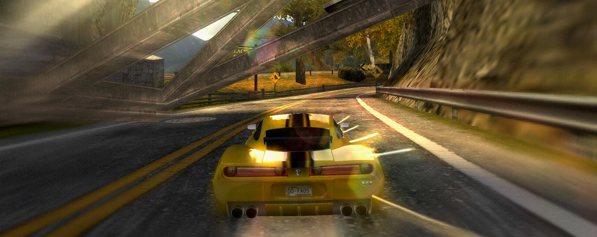
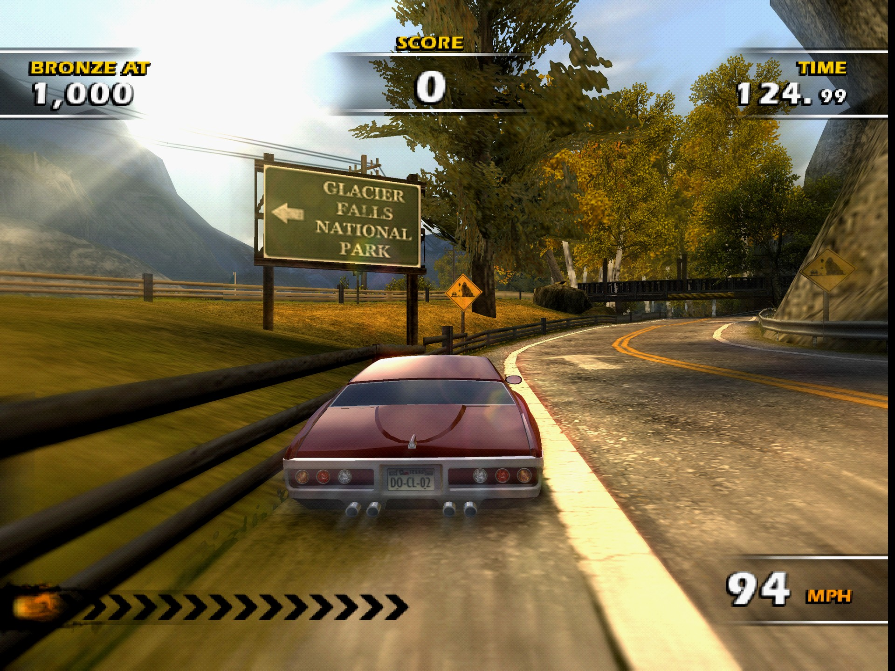
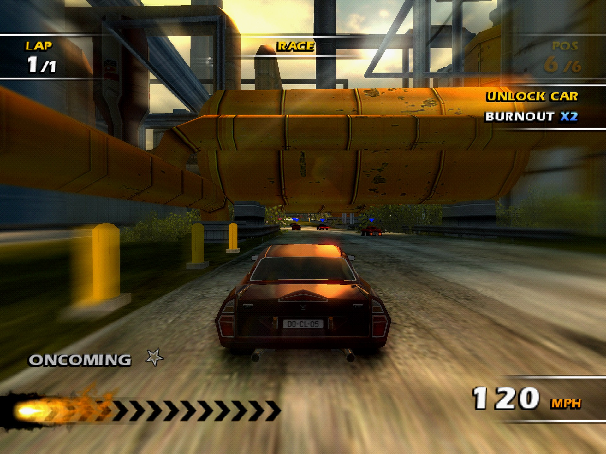
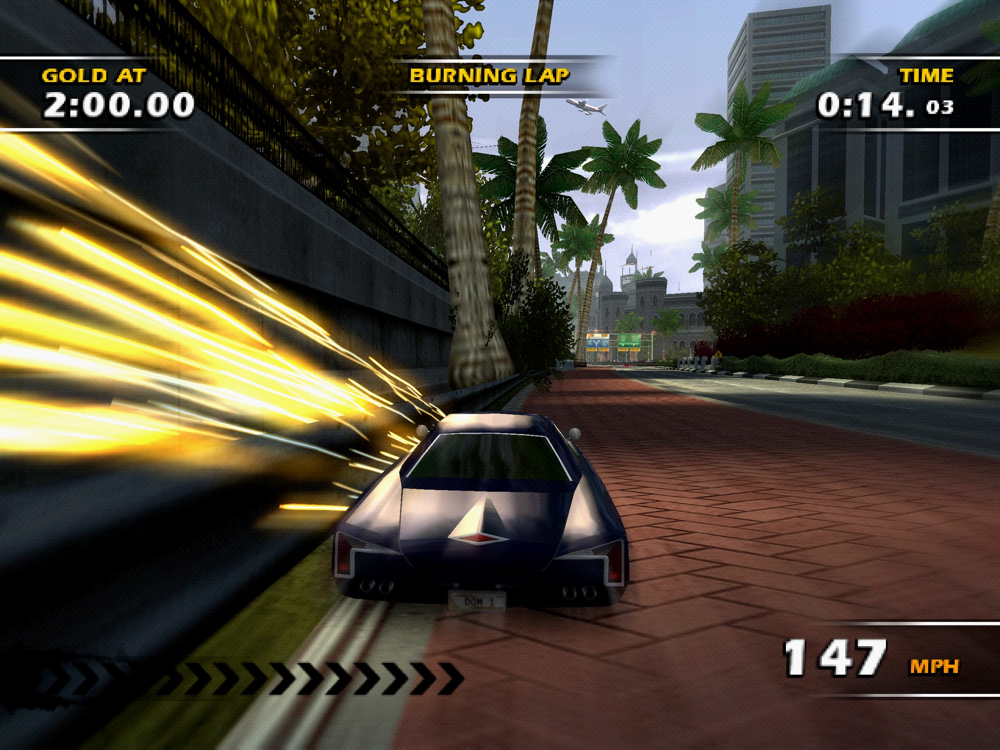
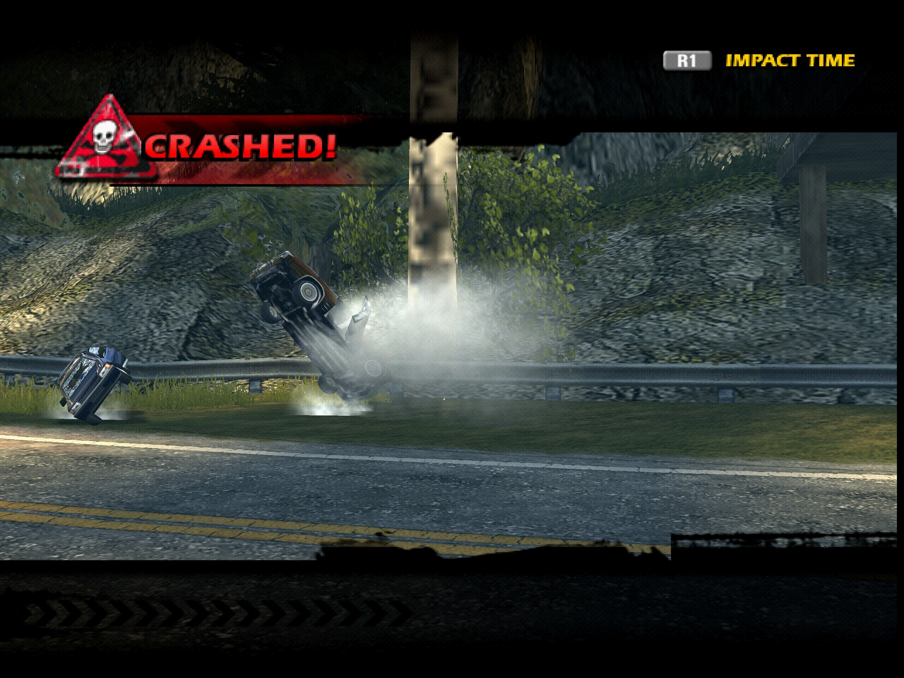
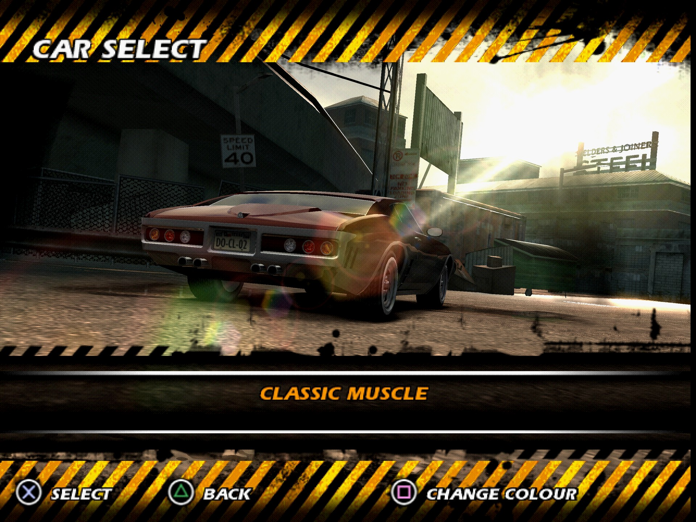
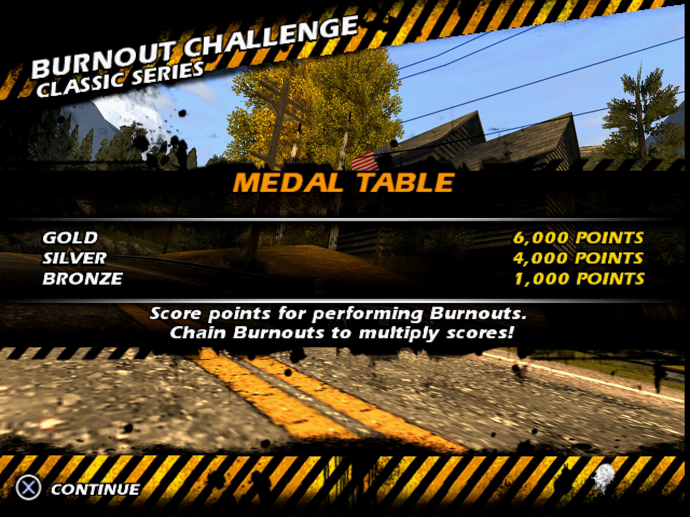
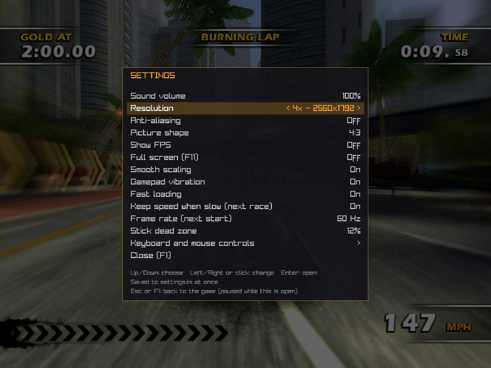
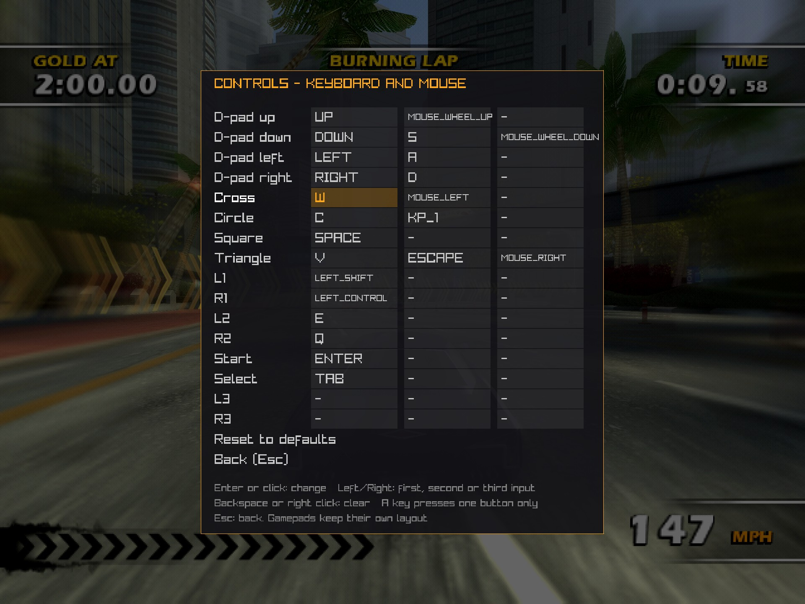

<div align="center">

# Burnout Dominator Reversed

**Burnout Dominator (PS2) recompiled into a native PC game.**

[](https://github.com/literalynn/BurnoutDominatorReversed/actions/workflows/build.yml)




</div>

The whole game runs natively on PC, from the intro videos to the last World Tour event: races, crashes, Burning Laps, the memory card, sound, gamepads, at full speed and up to four times the PS2's resolution.

> **No game data is included.** You need your own European disc image (`SLES-54627`); the installer checks it.

## Screenshots

<table>
<tr>
<td width="50%"></td>
<td width="50%"></td>
</tr>
<tr>
<td></td>
<td></td>
</tr>
<tr>
<td></td>
<td></td>
</tr>
<tr>
<td></td>
<td></td>
</tr>
</table>

<sub>Captured in the game at 4x resolution (2560 pixels wide) with 16 samples per pixel: <b>F1</b> → resolution 4x. Last row: the F1 menu over a paused race.</sub>

## Status

**Playable from start to finish, and stable.** Work now goes into speed and modding.

| | |
|---|---|
| ✅ Game | boot, intro videos, menus, World Tour, car select, events, results |
| ✅ Races | cars, traffic, damage, crashes and Impact Time, reflections, HUD |
| ✅ Saves | memory card (your profile is saved after every event), save states on F5 / F7 |
| ✅ Controls | Xbox, PlayStation and SDL pads with vibration, keyboard and mouse |
| ✅ Graphics | up to 4x resolution, supersampling, FXAA, 16:9 |
| ✅ Sound | music, engines, crashes, menus |
| ✅ Speed | 60 frames per second in six-car races; the race keeps its speed when frames come late |
| ✅ High frame rate | 120, 144, 240... frames per second (`refresh_rate`): the simulation runs that fast, not interpolated (on a Ryzen + RTX 5090, 144 draws every frame in a race and 165 nearly every one; from 240 the frames come unevenly, and above 300 the race slows down) |
| 🟡 Missing | SPU2 reverb |

## Install (Windows)

You need your European Burnout Dominator ISO (keep it where it is: the game reads it at every launch), a Vulkan graphics card, 20 GB free, and **Visual Studio 2026 or 2022 Community** with *Desktop development with C++*.

```powershell
winget install Python.Python.3.12 Git.Git Microsoft.PowerShell
git clone https://github.com/literalynn/BurnoutDominatorReversed.git
```

Drop your ISO onto **`Installer.bat`** in the cloned folder (30 to 90 minutes the first time), then play with **`Play.bat`**.

To update: `git pull`, then `Installer.bat` again.

<details>
<summary><b>Linux</b></summary>

```bash
sudo apt install git python3 cmake ninja-build g++ pkg-config libgl-dev libx11-dev libxrandr-dev libxinerama-dev \
  libxcursor-dev libxi-dev libasound2-dev libavcodec-dev libavformat-dev libavutil-dev libswresample-dev libswscale-dev
git clone https://github.com/literalynn/BurnoutDominatorReversed.git && cd BurnoutDominatorReversed
python3 tools/install.py --iso "/path/to/Burnout Dominator.iso"
python3 tools/project.py run
```

macOS is not verified yet.
</details>

**System requirements.** Single-core CPU speed matters most: the game and the PS2's graphics programs each run on one thread. On a Ryzen 7 9800X3D a six-car race takes about 5.6 ms of a 16.7 ms frame on the busier thread; four CPU threads are enough. The GPU needs Vulkan: the PS2 resolution is light, 2x and 4x need a dedicated card.

## Controls

| PS2 | Keyboard and mouse | Gamepad |
|---|---|---|
| ✕ accelerate, select | W · left click | A / ✕ |
| □ brake | Space | X / □ |
| R1 boost, Impact Time | Left Ctrl | RB / R1 |
| D-pad: steer, menus | A · D · S, arrows, mouse wheel | D-pad, left stick |
| △ back | V · Escape · right click | Y / △ |
| ○ | C · keypad 1 | B / ○ |
| L1 · L2 · R2 | Left Shift · E · Q | LB · LT · RT |
| Start · Select | Enter · Tab | Start · Back |

Every key can be changed in **F1** → *Keyboard and mouse controls*: up to three keys, mouse buttons or wheel directions per PS2 button.

| Key | |
|---|---|
| **F1** | settings menu (the game pauses): volume, resolution, anti-aliasing, aspect, controls... |
| **F11** · **Alt+Enter** | full screen |
| **F5** · **F7** | save · load state |
| **Escape** | back; in a race, asks whether to quit |
| **F9** | mark a glitch: notes the moment in the log, saves a screenshot and a save state in `marks/` |

<details>
<summary><b>Settings</b> (<code>settings.ini</code> next to <code>Play.bat</code>, also changed by F1)</summary>

| Setting | Default | |
|---|---|---|
| `window_width`, `window_height` | 1280 × 960 | start-up window size |
| `fullscreen` | false | borderless full screen |
| `vsync`, `fps_limit` | true, 0 | display sync and cap |
| `aspect` | 4:3 | `4:3`, `16:9` (with in-game widescreen) or `stretch` |
| `smooth_scaling` | true | bilinear enlargement |
| `super_sampling` | 4 | samples per pixel: 1, 2, 4, 8 or 16 |
| `high_resolution` | true | a higher resolution built from the samples: 2x (1280 pixels wide) with 4 or 8 samples, 4x (2560) with 16 |
| `fxaa` | false | FXAA on the finished picture |
| `hud_smoothing` | true | the race HUD smooth instead of blocky at 2x and 4x |
| `progressive_scan` | true | whole frames, no interlacing lines |
| `fast_loading` | true | loading screens run faster than real time |
| `keep_speed` | true | when the graphics cannot keep up, the game runs more simulation steps per drawn frame instead of slowing down (from the next race) |
| `stick_deadzone` | 12 | percent |
| `vibration` | true | the game's pad vibration on your gamepad |
| `gamepad_mappings` | — | extra `gamecontrollerdb.txt` |
| `volume` | 100 | percent |
| `show_fps` | false | frames per second in the corner |
| `key_cross`, `key_l1`... | see Controls | up to three keys, mouse buttons or wheel directions (`MOUSE_LEFT`, `MOUSE_WHEEL_UP`...) per button, or `NONE` |
| `refresh_rate` | 60 | the game runs at `60` or `50` Hz without asking; `120`, `144`, `240`... up to `500` runs the whole game that many frames a second at the same speed (more CPU work: a PC that cannot keep up slows the race down), from the next menu page |

</details>

---

# How it works

## From a disc to a PC game

The PS2 runs Burnout Dominator on several processors at once. This project rebuilds each of them on the PC:

| PS2 | Here |
|---|---|
| **EE**, the main MIPS R5900 CPU running the game's code | translated ahead of time into C++ by [PS2Recomp](https://github.com/ran-j/PS2Recomp): 51,161 generated files, compiled into the executable |
| **VU0** and **VU1**, the vector units that transform and light every vertex | their microprograms are compiled ahead of time into C++ as well ([`tools/compile_vu_programs.py`](tools/compile_vu_programs.py)), cycle-accurate, with an interpreter for the rest |
| **GS**, the graphics chip | [paraLLEl-GS](https://github.com/Arntzen-Software/parallel-gs) on the GPU through Vulkan, which also renders at higher resolutions |
| **IOP**, the I/O processor with its sound, disc and pad modules | emulated, running the game's own IRX modules |
| **SPU2**, **IPU**, DMA, timers | emulated: sound voices and mixing, the MPEG video decoder |

Nothing in the game is skipped or faked: SDK functions are replaced by native code only where their identity is proven ([docs/SDK_FUNCTIONS.md](docs/SDK_FUNCTIONS.md)). The game runs on three host threads: the game code with the IOP, the VU1 programs with VIF1 and the GIF, and the GS submission to the GPU.

## The road to playable

The first builds stopped before the menus. Once the game got further, its first race drew one frame per second with corrupted textures, and the race clock never moved. Some of the bugs that stood between that and a playable game:

- `PABSW` read the wrong register, so the track streamer loaded the wrong sections and drew meshes with the wrong microcode.
- `SQRT.S` read the wrong operand: every square root in the game was wrong, car bodies were squashed flat and the chase camera sat at bumper height.
- `CVT.W.S` rounded instead of truncating, and the boost gauge loop never ended.
- PATH3 texture uploads were released at the wrong moment around `MSKPATH3` windows, and DMA chains were cut at 4,096 tags: wrong textures, every other frame at speed.
- `MR32` stalled on lanes it does not read, which gave one vertex in four a wrong reflection: the car paint looked like camouflage.
- The game thread must round floats toward zero like the EE: the camera jumped whenever the car's heading crossed 180 degrees.
- 64-bit reads of the scratchpad at `0x70002000` returned the IPU's registers instead, which corrupted the city tracks' object lists and made the scenery flash.
- The frame governor reads the CPU's `Count` register, which never moved: a slow frame meant a slow race. `keep_speed` now lets the game catch up.

Each fix is described in [docs/CHANGES.md](docs/CHANGES.md) and the investigations in [docs/FINDINGS.md](docs/FINDINGS.md).

## Speed

A race went from 1 frame per second (GS on the CPU) to 16 with paraLLEl-GS, then to 60: compiled VU0 and VU1 programs, VU1 and GS work moved to their own threads, a declared idle loop, and a long list of smaller fixes. On October 19 a replay of 1,500 frames of a six-car race went from 12.7 to 8.9 s of wall time, with the same picture bit for bit. `BDR_STOP_AT_VSYNC` measures a build's CPU time on such a replay ([docs/BOOT.md](docs/BOOT.md)).

## Documentation

| | |
|---|---|
| [STATUS](docs/STATUS.md) | what works and what is left, with the full history |
| [DEVELOPMENT](docs/DEVELOPMENT.md) | build steps, run options, tests, repository layout |
| [BOOT](docs/BOOT.md) | boot sequence, IOP modules, diagnostics |
| [CHANGES](docs/CHANGES.md) | every change to the PS2Recomp snapshot |
| [SDK_FUNCTIONS](docs/SDK_FUNCTIONS.md) · [FINDINGS](docs/FINDINGS.md) | reverse-engineering evidence |

## Help wanted

Contributions are welcome, from code to bug reports:

- **Speed** for smaller PCs: the VU1 programs dominate a race frame ([`tools/compile_vu_programs.py`](tools/compile_vu_programs.py)).
- **Modding**: [`disc_patches.cpp`](ps2xRuntime/src/lib/disc_patches.cpp) changes disc files as the game reads them, without touching the ISO.
- **Sound**: the SPU2 ([`iop_spu2.cpp`](ps2xIOP/src/emulator/core/iop_spu2.cpp)) needs reverb and testing by ear.
- **Linux and macOS**: builds, controllers, packaging.
- **Bug reports**: what you saw, when, your hardware, and if you can a save state (F5) taken just before.

Read [CONTRIBUTING.md](CONTRIBUTING.md) first: no faked success, evidence for every SDK binding, every upstream change documented.

## Credits and license

Built on [PS2Recomp](https://github.com/ran-j/PS2Recomp) by ran-j and contributors (GPLv3, like this project), with [paraLLEl-GS](https://github.com/Arntzen-Software/parallel-gs) by Arntzen Software (LGPLv3). Game files and the code derived from them are never committed and stay on your machine.

Burnout Dominator is a trademark of Electronic Arts. This project is not affiliated with or endorsed by Electronic Arts, Criterion Games or Sony Interactive Entertainment. Screenshots are of the game running in this project.
