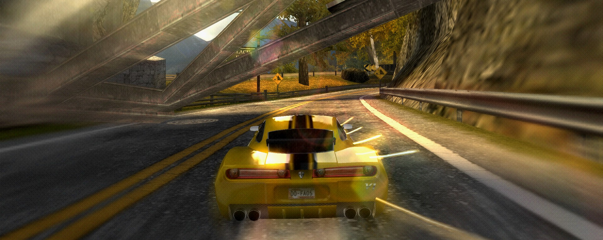
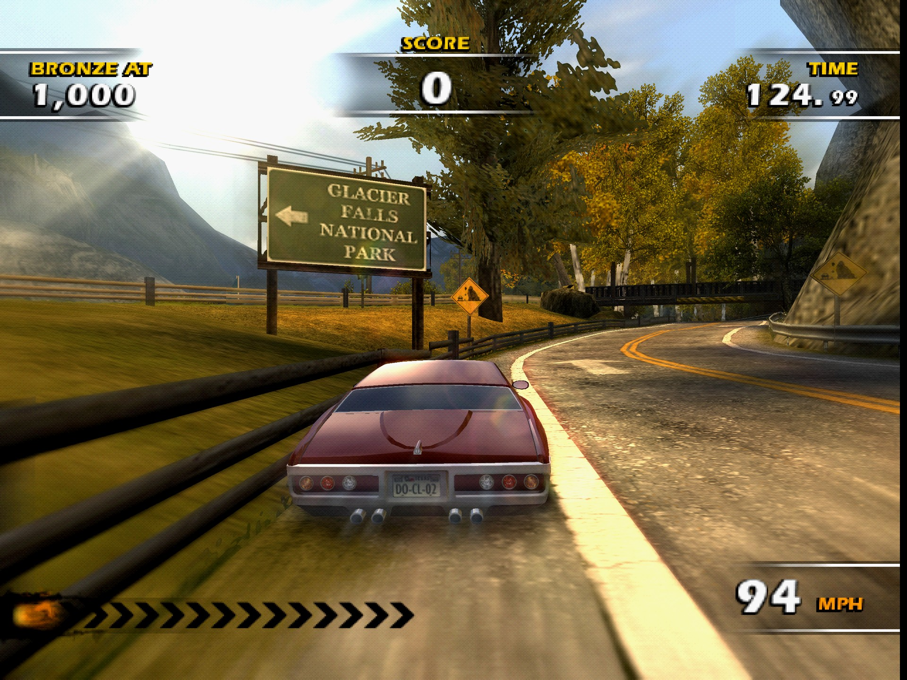
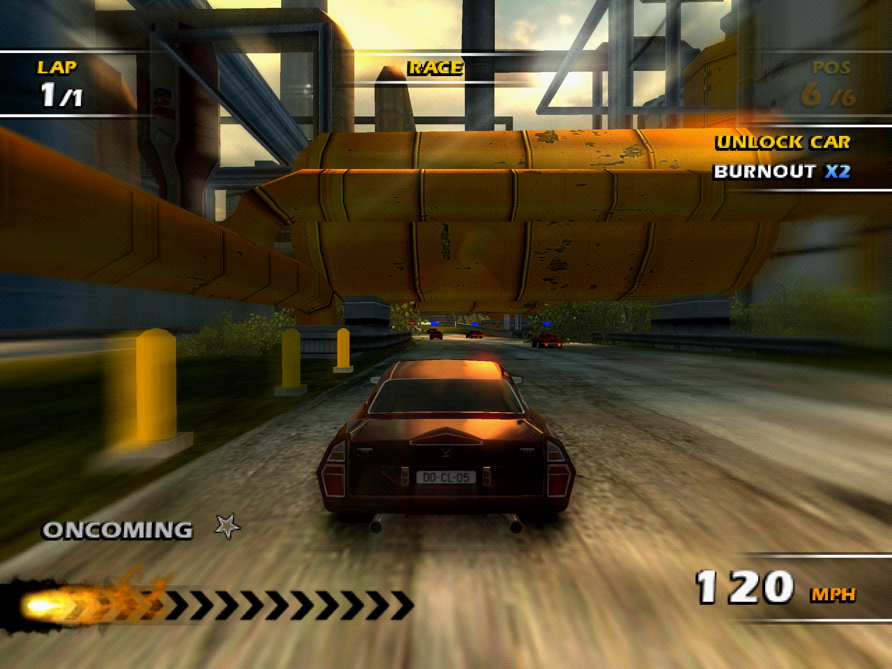
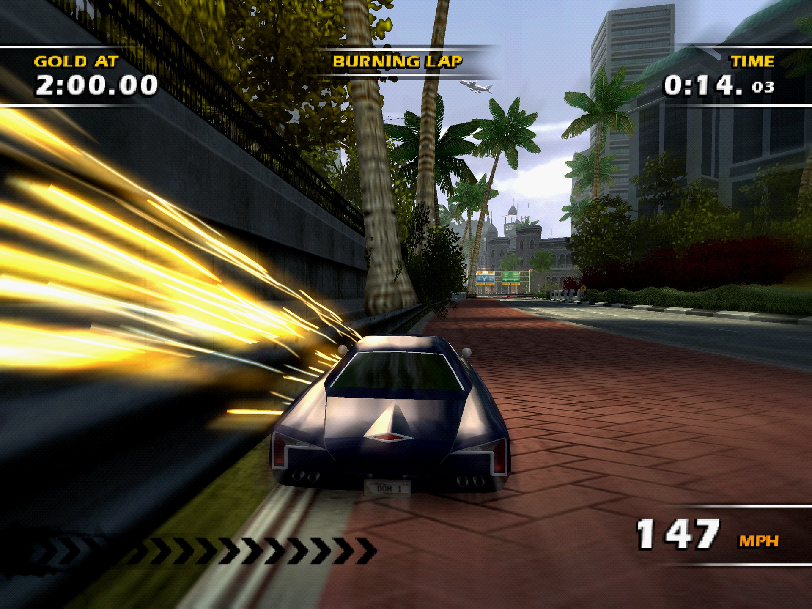
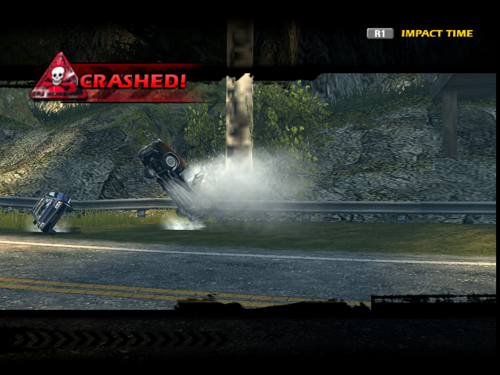
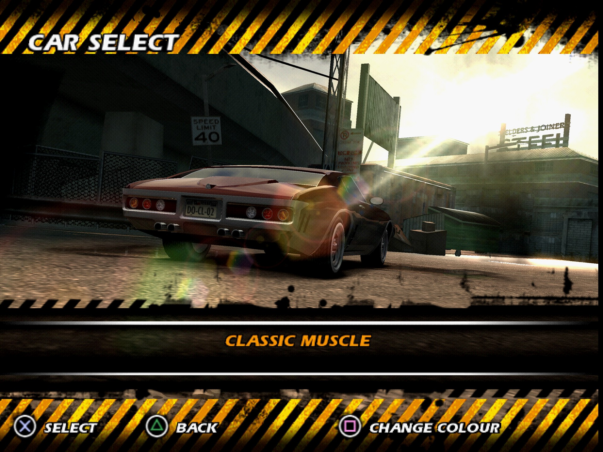
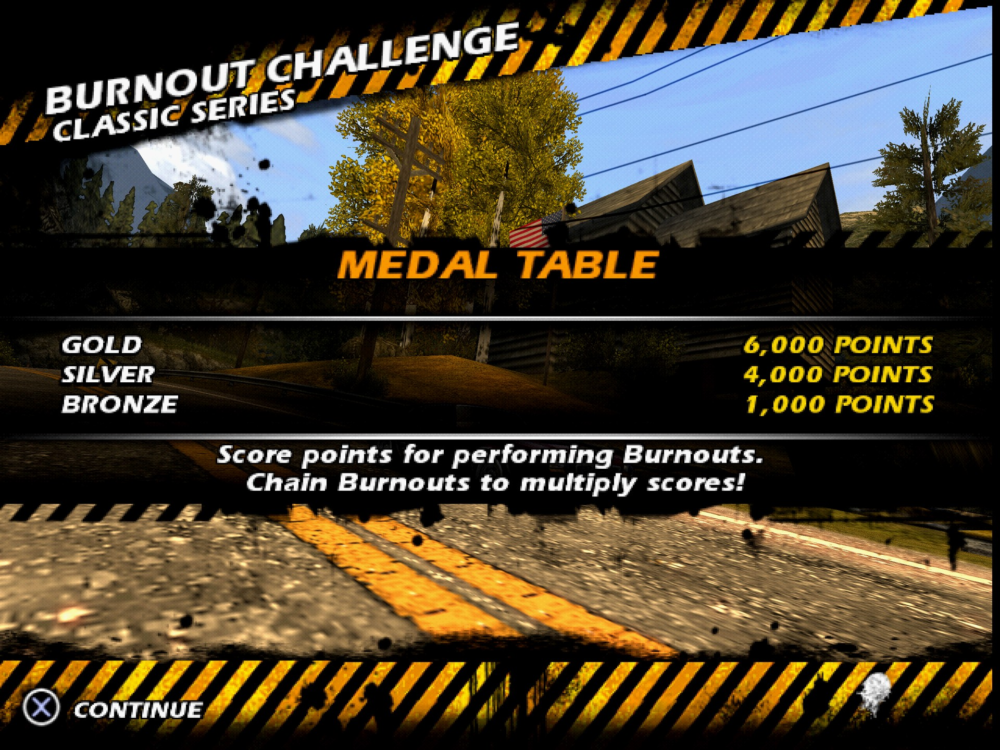
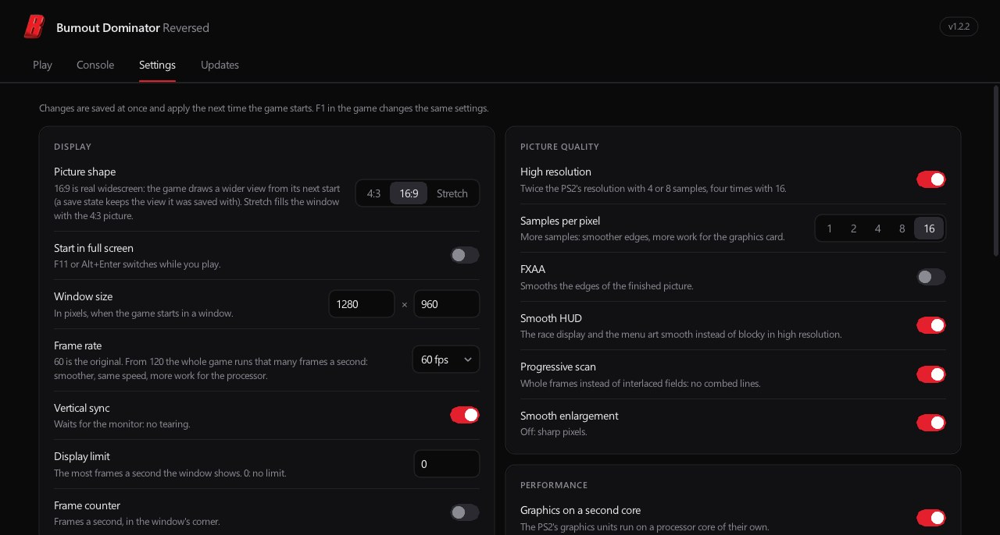

<div align="center">

# Burnout Dominator Reversed

**A native PC port of Burnout Dominator (PlayStation 2), made by static recompilation.**

[](https://github.com/literalynn/BurnoutDominatorReversed/actions/workflows/build.yml)
[](https://github.com/literalynn/BurnoutDominatorReversed/releases/latest)




</div>

The game's PS2 program is translated ahead of time into C++ and compiled for the PC; the rest of the console (graphics chip, sound, I/O processor) runs next to it. The result is a normal PC program that plays the whole game, from the intro videos to the last World Tour event, at 60 frames per second or more and up to four times the PS2's resolution.

> [!IMPORTANT]
> **No game data is included.** You need your own disc image of the European release (`SLES-54627`). The game is built on your PC from that image; nothing of it is distributed here.

## Status

The game is complete and playable from start to finish. The project is a work in progress: it is developed and tested on one Windows PC, and the remaining work is speed on smaller PCs, other systems and modding.

| | |
|---|---|
| **Game** | Every mode, event and track of the European release, crashes and Impact Time, videos, music, sound effects, memory card saves. |
| **Windows 10 / 11** | The main platform: installer, launcher and game tested. |
| **Linux** | Builds in CI with GCC and Clang and is played by contributors; less tested than Windows. The launcher's window is built on your PC at its first start (if that fails, the launcher opens in your browser). |
| **macOS, Android** | Not supported yet. |
| **Speed** | Developed on a Ryzen 7 9800X3D with an RTX 5090: races at full speed at 60 frames a second, about 240 at 240 Hz and 300 at 300 Hz. A player with a Ryzen 7 9800X3D and an RTX 5070 Ti reported 60 in races. Smaller PCs were imitated on that PC: with the whole game held to one thread of the processor, a race still runs at 60 frames a second with no sound dropouts; on the processor's own integrated graphics (a Radeon with 2 compute units), 45 to 55 frames a second at the PS2's resolution, the race keeping its speed. Real small PCs are untested; one fast core matters most. |
| **Accuracy** | Nothing in the game is skipped or faked. The main processor's float results were compared with a real console's: they match except some additions and multiplications that differ in the last bit. The vector units' arithmetic and the sound's reverb have not been compared with a console yet. |

**Known issues**

- The sky can flicker or change colour for a moment in some races, and the game's speed can vary briefly on some PCs (reported by players).
- At 2x and 4x, a faint line can show where a menu picture is made of several textures.
- A save state keeps the picture shape (4:3 or 16:9) it was made with; a change of shape takes effect at the game's next start.

## Features

- **The complete game**: World Tour, every event type, crashes and Impact Time, videos, music and sound effects.
- **60 frames per second, or more**: 120, 144, 240 and up to 500, simulated for real, not interpolated, at the original speed.
- **Higher resolution**: two or four times the PS2's, 1 to 16 samples per pixel, FXAA, progressive scan, and a HUD and menus that stay smooth instead of blocky.
- **Real 16:9**: the game draws a wider view; nothing is stretched.
- **Controllers**: Xbox, PlayStation and other SDL gamepads with vibration; keyboard and mouse with keys you can change. The game's button symbols follow the device you use.
- **Saves**: the memory card, save states (F5 / F7), and save profiles kept apart.
- **Fast loading**: loading screens run faster than real time.
- **One file to install**: `BurnoutDominator.exe` (Windows) or `BurnoutDominator.py` (Linux) installs the game into its own folder, opens the launcher and keeps everything up to date, itself included.

## Screenshots

<table>
<tr>
<td width="50%"></td>
<td width="50%"></td>
</tr>
<tr>
<td></td>
<td></td>
</tr>
<tr>
<td></td>
<td></td>
</tr>
</table>

<sub>Captured at four times the PS2's resolution with 16 samples per pixel.</sub>

## Requirements

| | |
|---|---|
| **Game** | your own Burnout Dominator ISO, European release (`SLES-54627`). Other releases are not supported. |
| **System** | Windows 10 or 11, 64-bit, or Linux (x86-64). |
| **Processor** | x86-64, four threads or more; single-thread speed matters most. On Windows, AVX2 is required (Intel since 2013, AMD since 2015): the build compiles for it. On Linux, FMA3 is used when present. |
| **Graphics** | a card with Vulkan. Two and four times the PS2's resolution need a dedicated card. |
| **Memory** | 16 GB or more to build the game: a few of its files take up to 8 GB each to compile. With less memory the build compiles fewer of them at once. |
| **Disk** | 25 GB free. Once the game is built, *Free up disk space* in the launcher deletes the build files (about 12 GB); the game still plays, but the next update then builds it all again (30 to 90 minutes). |
| **Build tools** | the game is compiled on your PC. Windows: nothing to install. Without Visual Studio, the launcher downloads Microsoft's C++ Build Tools, CMake and Ninja into its folder (a 500 MB download, 1.25 GB on disk); Visual Studio 2022 or 2026 with *Desktop development with C++* is used when it is there. Linux: the packages below. |

## Installation

The first installation translates and compiles the game on your PC: 30 to 90 minutes. After that, an update rebuilds only what changed.

### Windows

1. Download **[`BurnoutDominator.exe`](https://github.com/literalynn/BurnoutDominatorReversed/releases/latest/download/BurnoutDominator.exe)** into an empty folder and start it. It downloads the project into that folder, with a Python and a Git of its own (official builds, checked by SHA-256), then opens the launcher. The file is not signed: if Windows SmartScreen stops it, choose *More info*, then *Run anyway*.
2. In the launcher, choose your ISO. Without Visual Studio, the launcher offers to download Microsoft's C++ Build Tools (the compiler and the parts of the Windows SDK the build needs, from Microsoft's servers, checked by SHA-256), CMake and Ninja into `work\toolchain`: read Microsoft's licence terms, then press **Accept the licence and download**, which goes on with the installation. Nothing is installed on the system. With Visual Studio 2022 or 2026 and *Desktop development with C++*, the launcher uses it instead: press **Generate the code and build the game**.
3. Press **Play**.

Everything stays in that one folder: the project (`source`), the game's files (`work`, with the downloaded compiler), your saves (`save`) and `settings.ini`. The folder can be moved or copied to another drive; the first update after a move builds everything again. To uninstall, delete the folder. Keep the ISO where it is: the game reads it at every launch.

### Linux

```bash
sudo apt install git python3 cmake ninja-build g++ pkg-config libgl-dev libx11-dev libxrandr-dev libxinerama-dev \
  libxcursor-dev libxi-dev libasound2-dev libavcodec-dev libavformat-dev libavutil-dev libswresample-dev libswscale-dev
```

Then download [`BurnoutDominator.py`](https://github.com/literalynn/BurnoutDominatorReversed/releases/latest/download/BurnoutDominator.py) into an empty folder and run `python3 BurnoutDominator.py`. It works like the Windows file and uses the system's Python and Git. It builds the launcher's window at its first start (about a minute) and after each update; if it cannot, it says why and opens the launcher in your browser.

### From a Git checkout

```bash
git clone https://github.com/literalynn/BurnoutDominatorReversed.git
cd BurnoutDominatorReversed
python tools/launcher.py        # Windows: Launcher.bat
```

The launcher then opens as a page in a browser window, and the game's files go to a work directory outside the checkout (`C:\bdr-work` on Windows, `~/bdr-work` elsewhere). Without the launcher: `python tools/install.py --iso <ISO>` (on Windows without Visual Studio it offers the C++ Build Tools download; `--download-compiler` accepts it), then `python tools/project.py run`. [docs/DEVELOPMENT.md](docs/DEVELOPMENT.md) has the details.

## The launcher



A window of its own, the same on every system ([tools/launcher/](tools/launcher/), drawn with raylib like the game), over [tools/launcher.py](tools/launcher.py), which does the work. Closing it does not stop a running game; starting it again while its window is open brings that window to the front.

| Tab | |
|---|---|
| **Play** | the ISO, the installation steps, the save profile to play with, and Play. |
| **Console** | what the installation and the game print; no console window stays open. |
| **Settings** | picture, sound, gamepad, keys. Changes are saved at once. |
| **Updates** | checks GitHub, shows what a new version brings ([CHANGELOG.md](CHANGELOG.md)) and installs it, `BurnoutDominator.exe` included. |

**Save profiles** each have their own memory card and save states; the first one is *Default*. They are the folders of `save` in the installation folder (in a Git checkout, they are in the work directory). *New* creates one, empty or with a copy of the saves in another folder (another installation's, for example).

## Controls

| PS2 | Keyboard and mouse | Gamepad |
|---|---|---|
| ✕ accelerate, select | W · left click | A / ✕ |
| □ brake | Space | X / □ |
| R1 boost, Impact Time | Left Ctrl | RB / R1 |
| D-pad: steer, menus | A · D · S, arrows, mouse wheel | D-pad, left stick |
| △ back | V · Escape · right click | Y / △ |
| ○ | C · keypad 1 | B / ○ |
| L1 · L2 · R2 | Left Shift · E · Q | LB · LT · RT |
| Start · Select | Enter · Tab | Start · Back |
| hold Start: skip a video | hold Enter | hold Start |

Each PS2 button takes up to three keys, mouse buttons or wheel directions: change them in the launcher's Settings tab or in the game's **F1** menu.

| Key | |
|---|---|
| **F1** · gamepad: hold **Select**, or **Guide** | settings menu (the game pauses), with *Quit game* |
| **F11** · **Alt+Enter** | full screen |
| **F5** · **F7** | save · load state |
| **F9** | mark a glitch: notes the moment in the log and saves a screenshot and a save state in `marks/` |

## Settings

The launcher's Settings tab, the game's **F1** menu and `settings.ini` (in the installation folder; at the repository root in a Git checkout) change the same settings.

<details>
<summary><code>settings.ini</code> reference</summary>

| Setting | Default | |
|---|---|---|
| `window_width`, `window_height` | 1280 × 720 | start-up window size |
| `fullscreen` | false | borderless full screen |
| `vsync`, `fps_limit` | true, 0 | display sync and cap |
| `aspect` | 16:9 | `16:9`, `4:3` or `stretch`. With `16:9` the game draws a wider view. A change applies from the game's next start (a save state keeps the view it was saved with); until then the window keeps the shape the game draws. `stretch` fills the window with the picture |
| `smooth_scaling` | true | bilinear enlargement |
| `super_sampling` | 4 | samples per pixel: 1, 2, 4, 8 or 16 |
| `high_resolution` | true | a higher resolution built from the samples: 2x (1280 pixels wide) with 4 or 8 samples, 4x (2560) with 16 |
| `adaptive_resolution` | true (new installations) | lowers the resolution, down to the PS2's, while the graphics card cannot keep up, and raises it again once it can |
| `fxaa` | false | FXAA on the finished picture |
| `hud_smoothing` | true | the HUD and the menus' art and text smooth instead of blocky at 2x and 4x |
| `car_lights` | 100 | brightness of every car's light glows (headlights, tail lights, indicators) in percent: `100` (original), `150` or `200` to see traffic from further away |
| `progressive_scan` | true | whole frames, no interlacing lines |
| `gs_thread` | true | the PS2's graphics units on a second processor core |
| `fast_loading` | true | loading screens run faster than real time |
| `video_skip` | true | holding Start (Enter on the keyboard) for a second skips any video, even one the game does not let you skip, and the videos that follow while you keep holding it: the game goes on at once as if each had played to its end |
| `keep_speed` | true | when the graphics cannot keep up, the game draws fewer frames instead of slowing down (from the next race) |
| `refresh_rate` | 60 | `50` or `60` as on a console; `120`, `144`, `240`... up to `500` runs the whole game that many frames a second at the same speed, with more processor work |
| `stick_deadzone` | 12 | percent |
| `vibration` | true | the game's pad vibration on your gamepad |
| `gamepad_mappings` | — | an extra `gamecontrollerdb.txt` |
| `button_prompts` | auto | the game's button symbols: `playstation`, `xbox` (A, B, X, Y, LB, RB, LT, RT), `keyboard` (the first key bound to each button) or `auto`, the device you pressed something on last, switching as you play |
| `volume` | 100 | percent |
| `show_fps` | false | frames per second in the corner |
| `key_cross`, `key_l1`... | see Controls | up to three inputs per button (`W`, `LEFT_SHIFT`, `MOUSE_LEFT`, `MOUSE_WHEEL_UP`...), or `NONE` |

</details>

## FAQ

**Why is there no ready-to-play download?**
The executable is built from the game's own code, translated from your disc: distributing it would be distributing the game. The releases contain the installer and this project's source only, and the build happens on your PC.

**Which version of the game do I need?**
The European PlayStation 2 release, `SLES-54627`. The installer checks the disc image. The American, Japanese and PSP releases are different programs and are not supported.

**Is it an emulator?**
Partly. The game's main program is not interpreted: it is translated to C++ before the build, like its vector-unit programs. The graphics chip, the sound chip and the I/O processor are emulated.

**Can I bring my saves?**
A save that is a folder (`BESLES-54627...` with its `icon.sys`, as PCSX2's *folder* memory cards keep it) can be copied into a new save profile from the launcher. Memory card image files and `.psu` or `.max` files are not read.

**Are the PSP version's extra tracks in it?**
No. The PS2 program still names them, but their data is not on the PS2 disc ([FINDINGS E025](docs/FINDINGS.md)).

**Is there an "unlock everything" option?**
Not yet. The game's own debug "Unlock All" is empty in the released game; progress comes from playing, or from a save copied into a profile.

## How it works

| PS2 | Here |
|---|---|
| **EE**, the main MIPS R5900 processor that runs the game's code | translated ahead of time into C++ by [PS2Recomp](https://github.com/ran-j/PS2Recomp) (about 51,000 functions), then compiled |
| **VU0** and **VU1**, the vector units that transform and light every vertex | their microprograms are translated to C++ as well, with an interpreter for the rest |
| **GS**, the graphics chip | [paraLLEl-GS](https://github.com/Arntzen-Software/parallel-gs), on the GPU through Vulkan |
| **IOP**, the I/O processor with its sound, disc and pad modules | emulated, running the game's own modules |
| **SPU2**, **IPU**, DMA, timers | emulated: sound voices, reverb and mixing; the videos' MPEG decoding goes through FFmpeg |

A console library function is replaced by native code only where its identity is proven ([docs/SDK_FUNCTIONS.md](docs/SDK_FUNCTIONS.md)). The repository holds a snapshot of PS2Recomp with this project's changes ([docs/CHANGES.md](docs/CHANGES.md)), the runner, the installer and the launcher. Game files and the code generated from them stay in the work directory and are never committed.

## Documentation

| | |
|---|---|
| [CHANGELOG](CHANGELOG.md) | what each version changes for players |
| [STATUS](docs/STATUS.md) | the project's history and what is left |
| [DEVELOPMENT](docs/DEVELOPMENT.md) | build steps, run options, tests, repository layout |
| [BOOT](docs/BOOT.md) | boot sequence, IOP modules, diagnostics |
| [NATIVE_RENDERER](docs/NATIVE_RENDERER.md) | the translated VU programs and where the time goes |
| [CHANGES](docs/CHANGES.md) | every change to the PS2Recomp snapshot |
| [SDK_FUNCTIONS](docs/SDK_FUNCTIONS.md) · [FINDINGS](docs/FINDINGS.md) | reverse-engineering evidence |

## Contributing

Bug reports and pull requests are welcome; read [CONTRIBUTING.md](CONTRIBUTING.md) first (no faked success, evidence for every SDK binding, every upstream change documented). A useful bug report says what you saw, when, on which hardware, and comes with a save state (F5) taken just before if you can. Areas where help counts most:

- **Speed** on smaller PCs: the game thread and the graphics submission thread ([docs/NATIVE_RENDERER.md](docs/NATIVE_RENDERER.md)).
- **Linux and macOS**: testing, controllers, packaging; a macOS build of the game.
- **Sound**: the SPU2 ([`iop_spu2.cpp`](ps2xIOP/src/emulator/core/iop_spu2.cpp)) needs testing by ear against a console, its reverb especially.
- **Modding**: [`disc_patches.cpp`](ps2xRuntime/src/lib/disc_patches.cpp) changes disc files as the game reads them, without touching the ISO.

## Credits

- [PS2Recomp](https://github.com/ran-j/PS2Recomp) by ran-j and contributors: the recompiler and the runtime this project builds on (GPLv3).
- [paraLLEl-GS](https://github.com/Arntzen-Software/parallel-gs) by Arntzen Software: the GS renderer (LGPLv3).
- [raylib](https://github.com/raysan5/raylib) (zlib): the game's and the launcher's window, keyboard, mouse and sound output.
- [SDL2](https://www.libsdl.org/) (zlib): gamepads and vibration.
- [FFmpeg](https://ffmpeg.org/) (LGPL): the videos' MPEG decoding.
- [ps2autotests](https://github.com/unknownbrackets/ps2autotests) (ISC): the console results the EE's float instructions are checked against.
- [PCSX2](https://github.com/PCSX2/pcsx2) (GPLv3 or later): the reference for the EE divider and the SPU2's voice and mixing rules.

## License

GPLv3, see [LICENSE](LICENSE).

Burnout Dominator is a trademark of Electronic Arts. This project is not affiliated with or endorsed by Electronic Arts, Criterion Games or Sony Interactive Entertainment. It ships no game code or game data; screenshots are of the game running in this project.
